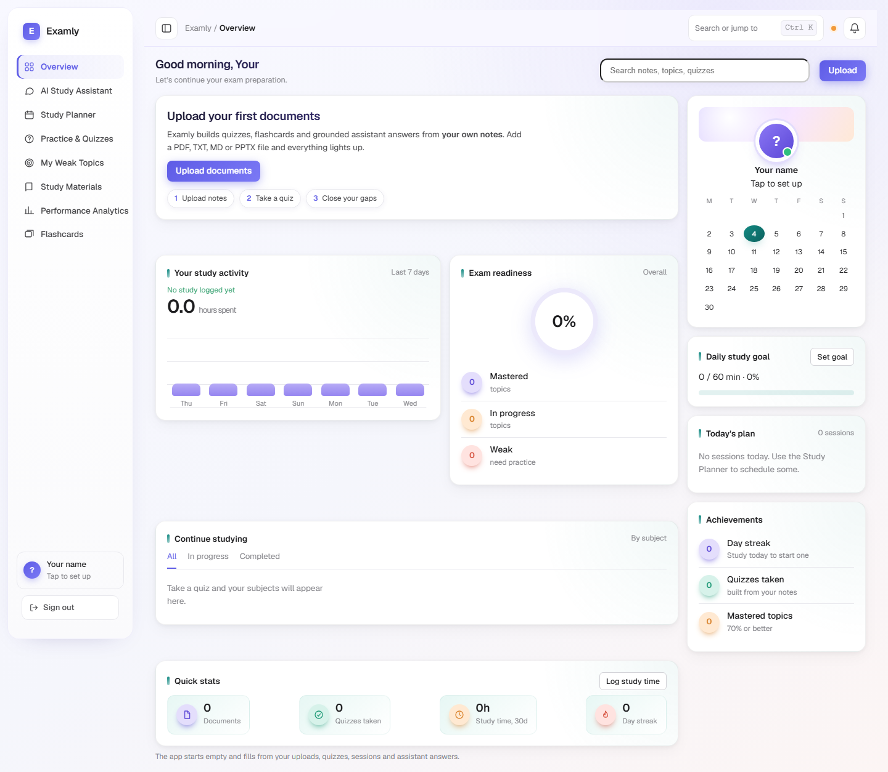
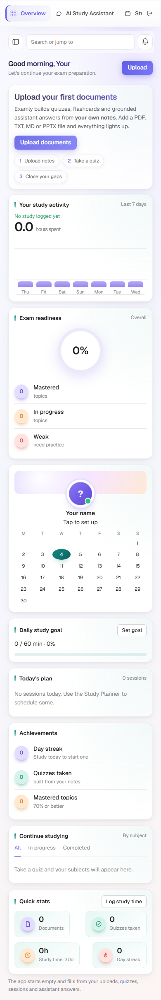
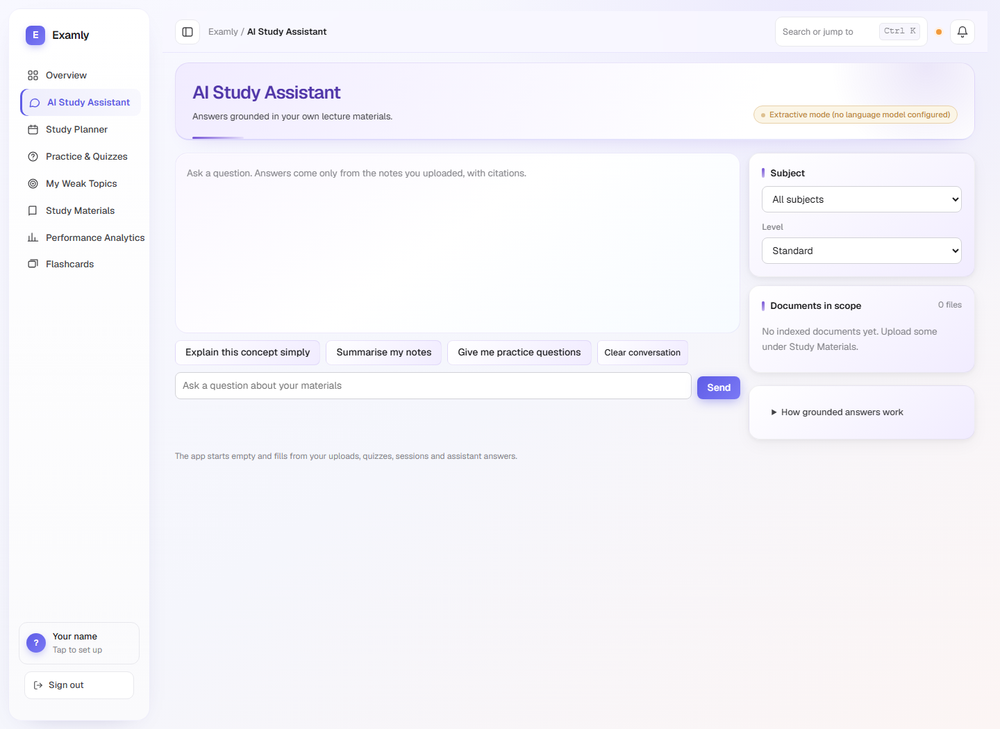
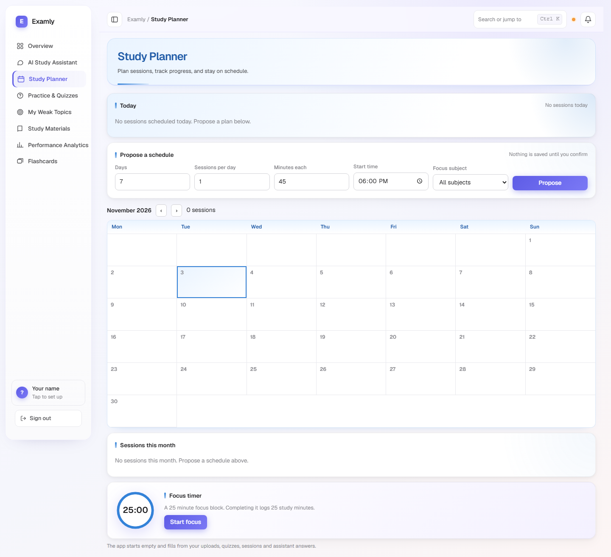
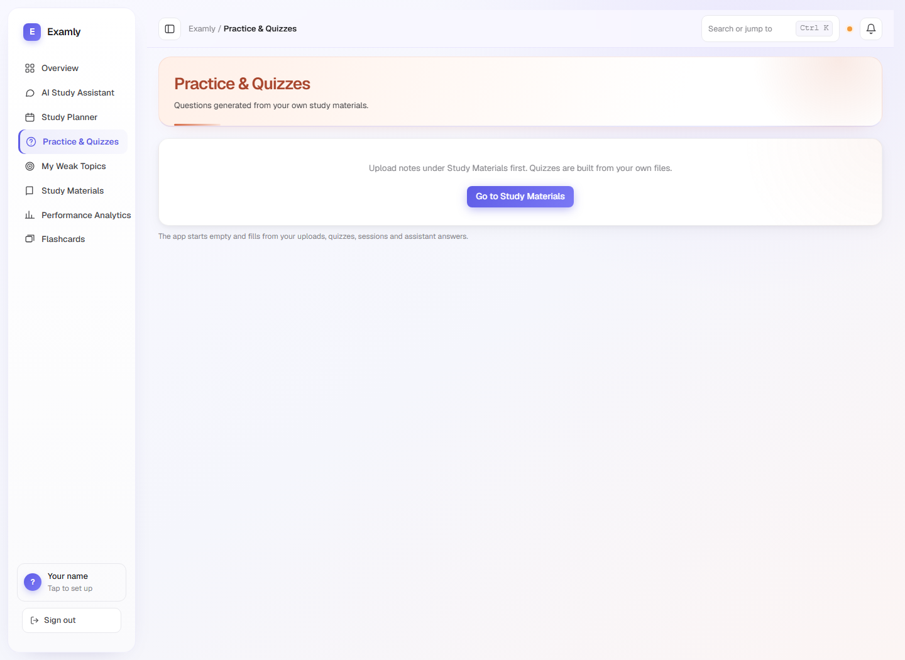
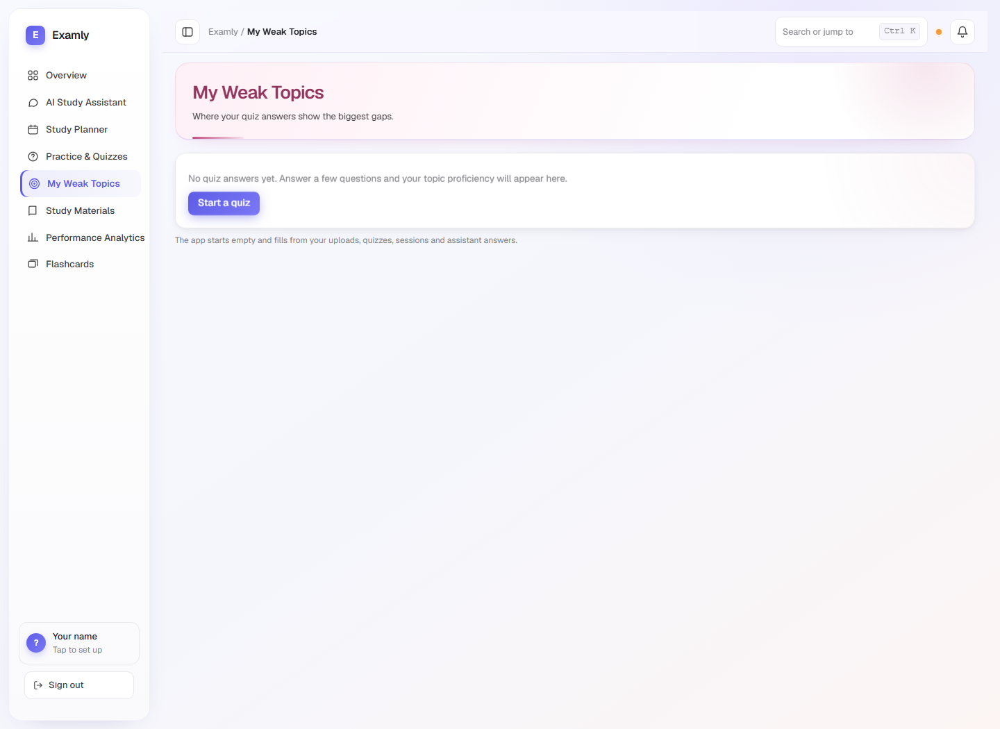
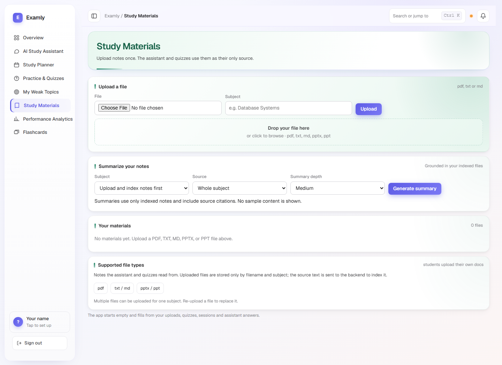
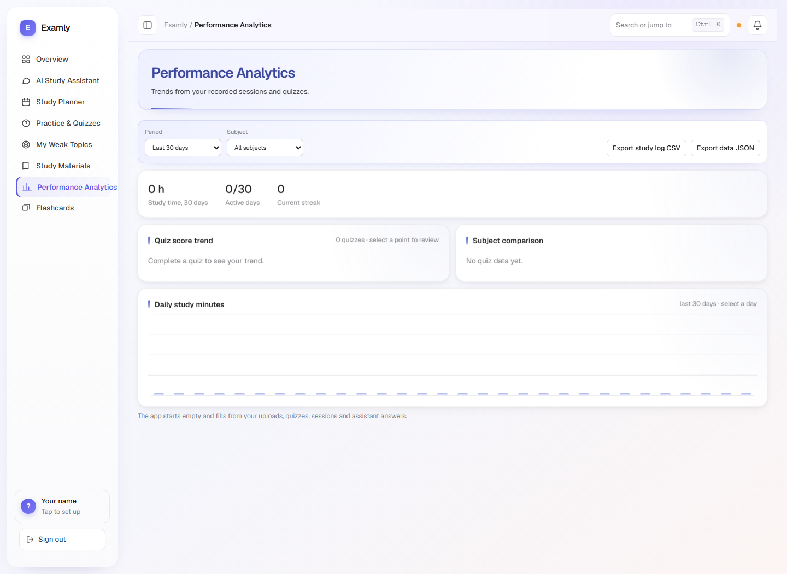
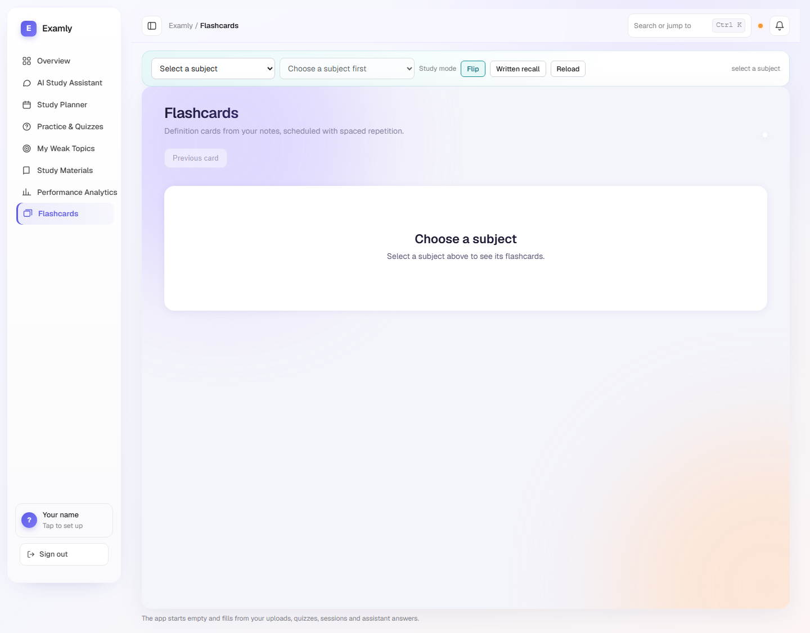

# Examly

**A personal study workspace that turns your own course materials into an interactive study plan.**

Examly combines an AI study assistant, source-grounded summaries, quizzes, flashcards, a study planner, and performance analytics in one local-first web app. Upload your notes once and use them throughout your study workflow. The app starts with an honest empty state; it does not fill the dashboard with fabricated progress.

## Screenshots

These screenshots show the current interface in a fresh, empty workspace. No learner records or uploaded documents are included.



<details>
<summary>Mobile layout</summary>



</details>

<details>
<summary>Explore screenshots of the study pages</summary>

| Study assistant | Planner |
|---|---|
|  |  |

| Practice & quizzes | Weak topics |
|---|---|
|  |  |

| Study materials and summaries | Performance analytics |
|---|---|
|  |  |



</details>

## Features

- **Study dashboard:** daily goal, study activity, exam readiness, sessions, due reviews, and subject progress from the workspace's actual data.
- **AI Study Assistant:** ask questions about selected subjects or documents. Answers include numbered citations to indexed materials. If no language model is configured or available, Examly uses a source-grounded extractive fallback.
- **Source-based summaries:** summarize a whole subject or an individual document at short, medium, or detailed depth. Review source excerpts and download the summary as TXT.
- **Study planner:** build a schedule from your subjects and notes, preview it before saving, track sessions in a calendar, and use a focus timer.
- **Practice quizzes:** create configurable quizzes from uploaded notes, choose a difficulty, answer questions, and review explanations and source references.
- **Flashcards:** build cards from a whole subject or a selected document, use flip or written-recall mode, move back to review cards, and rate recall for spaced repetition.
- **Weak-topic tracking:** see topic proficiency, group related topics, and start targeted practice.
- **Interactive analytics:** filter by date range and subject, inspect daily study activity, and click quiz-score points to review each quiz's actual score and answers.
- **Exports:** download study logs and workspace data as CSV/JSON; summaries, quiz reviews, and proposed schedules can be downloaded as TXT.
- **Responsive interface:** eight connected study pages, keyboard-accessible controls, collapsible long content, and reduced-motion support.

## Quick start

### Windows

From the repository root, run:

```powershell
.\run_examly.bat
```

Or install and run the backend manually:

```powershell
cd webapp\backend
python -m venv .venv
.\.venv\Scripts\Activate.ps1
python -m pip install -r requirements.txt
python -m uvicorn app.main:app --reload
```

### macOS or Linux

```sh
./run_examly.sh
```

Or start the backend manually:

```sh
cd webapp/backend
python3 -m venv .venv
source .venv/bin/activate
python -m pip install -r requirements.txt
python -m uvicorn app.main:app --reload
```

Open **http://127.0.0.1:8000/**. The Starlette app serves the frontend and API together. The database is created locally at `webapp/backend/examly.db` by default.

### First run

1. Create the workspace account on the sign-in page.
2. Open **Study Materials** and upload a PDF, TXT, Markdown, PowerPoint, or PowerPoint presentation file.
3. Wait for the material to finish indexing.
4. Generate a summary, ask the assistant a question, make a quiz, or build flashcards from the indexed material.
5. Add study sessions and review your real activity in **Performance Analytics**.

You can change the database location with `EXAMLY_DB`. Existing local data stays on your machine unless you explicitly export or move it.

## AI configuration

**No API keys are required to run Examly.** Without a configured provider, the assistant and summary workflow use extractive methods grounded in uploaded notes. Quiz generation, planning, flashcards, analytics, and exports work without an external AI service.

To optionally enable an LLM provider, follow the configuration guide in [`webapp/backend/README.md`](webapp/backend/README.md). Provider settings and key-file paths belong in your local environment or a gitignored `.env` file. Never commit API keys, secret files, or credentials.

## Architecture

| Path | Description |
|---|---|
| [`webapp/frontend.html`](webapp/frontend.html) | Single-page application and embedded flashcard experience |
| [`webapp/backend/app/main.py`](webapp/backend/app/main.py) | Starlette routes, request validation, and analytics |
| [`webapp/backend/app/services.py`](webapp/backend/app/services.py) | Material indexing, retrieval, summaries, quiz creation, planning, and spaced repetition |
| [`webapp/backend/app/db.py`](webapp/backend/app/db.py) | SQLite schema and database helpers |
| [`webapp/backend/app/llm.py`](webapp/backend/app/llm.py) | Optional LLM provider chain and failure fallback |
| [`webapp/backend/tests/test_api.py`](webapp/backend/tests/test_api.py) | End-to-end API and workflow tests |
| [`docs/screenshots/`](docs/screenshots/) | Current empty-workspace screenshots used above |
| [`examly_agent/`](examly_agent/) | Separate assignment deliverable and its documentation |

The backend indexes extracted text and stores it in SQLite for retrieval. Assistant answers and summaries include citations to source files/pages. Quiz questions are generated from sentences in the student's materials; they are heuristic cloze-style multiple choice rather than free-form LLM-written exams.

## API overview

API routes are served under `/api`. The detailed request/response notes are in [`webapp/backend/README.md`](webapp/backend/README.md).

| Area | Routes |
|---|---|
| Profile and dashboard | `GET/PUT /profile`, `GET /dashboard`, `GET/PUT /study-goal` |
| Subjects, exams, and materials | `GET/POST /subjects`, `GET/POST /exams`, `GET/POST /materials`, `DELETE /materials/{id}` |
| Summaries and assistant | `POST /summaries`, `POST /assistant/chat`, `GET /assistant/status`, `GET/DELETE /assistant/history` |
| Planner and study log | `GET /planner/calendar`, `POST /planner/propose`, `POST /planner/proposals/{id}/confirm`, `POST /study-log` |
| Quizzes and review | `POST /quizzes`, `GET /quizzes/{id}`, quiz answer routes, `GET /weak-topics`, `GET /review/due` |
| Flashcards | `GET /flashcards`, `POST /flashcards/build`, `POST /review/{topic_id}` |
| Analytics and exports | `GET /analytics`, `GET /analytics/day`, `GET /export?format=csv\|json` |
| Authentication | `GET /auth/status`, `POST /auth/register`, `POST /auth/login`, `POST /auth/logout` |

## Tests

Install the backend requirements, then run:

```sh
cd webapp/backend
python -m pytest tests -q
```

The API tests start a temporary local server and isolated SQLite database. They disable LLM calls and do not require API keys or modify the normal app database.

## Security and data notes

- Passwords are stored as PBKDF2-SHA256 hashes; session tokens are held in SQLite and sent in HttpOnly cookies.
- Uploaded source files are parsed for indexing; extracted text and document metadata are stored in the workspace database. Keep that database private.
- The default setup is a **single local workspace account**, not a multi-tenant hosting configuration.
- If an LLM provider is configured, relevant retrieved excerpts may be sent to that provider to produce answers or summaries. Use only a provider and material you are authorized to share.
- Keep `.env`, API keys, and personal study databases out of Git.

## Related documentation

- [`webapp/backend/README.md`](webapp/backend/README.md) — backend setup, configuration, and endpoint details.
- [`examly_agent/README.md`](examly_agent/README.md) — separate Exam Preparation Agent assignment.
- [`HANDOFF.md`](HANDOFF.md) — project handoff notes.
